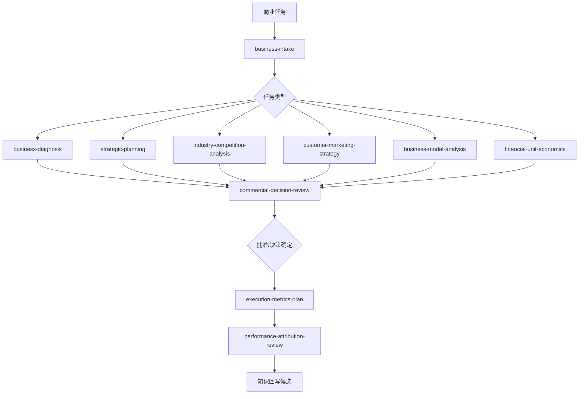

# 商业操盘 Skills 索引与调用关系

## 技能列表

| Skill | 触发场景 | 主要产物 |
|---|---|---|
| business-intake | 新商业任务、问题不清 | 任务简报与风险分级 |
| business-diagnosis | 经营异常、增长/利润问题 | 诊断报告与根因假设 |
| strategic-planning | 战略方向、资源配置 | 战略方案与取舍 |
| industry-competition-analysis | 行业、竞品、替代 | 竞争分析 |
| customer-marketing-strategy | 客户、产品、营销增长 | 营销策略与实验 |
| business-model-analysis | 商业模式、交易与变现 | 商业模式图与验证计划 |
| financial-unit-economics | 财务、现金、单位经济 | 财务分析与敏感性 |
| commercial-decision-review | 重大决策、反方审查 | 决策挑战与风险 |
| execution-metrics-plan | 决策获批后推进执行 | 执行计划与指标 |
| performance-attribution-review | 执行后复盘 | 复盘报告与知识候选 |

## 调用关系

此图是逻辑调用关系，不要求所有任务经过全部 Skill。简单任务可以跳过 intake 或审查；高风险任务必须执行决策审查和审批门禁。

## 组合建议

- 战略进入新市场：business-intake → industry-competition-analysis → strategic-planning → financial-unit-economics → commercial-decision-review → execution-metrics-plan。
- 新产品上市：business-intake → customer-marketing-strategy → business-model-analysis → financial-unit-economics → commercial-decision-review → execution-metrics-plan。
- 经营恶化：business-intake → business-diagnosis → financial-unit-economics → commercial-decision-review → execution-metrics-plan。
- 试点结束：performance-attribution-review；必要时回到诊断或战略 Skill。

## 通用质量约束

- Skill 只描述“如何完成”，不重复总控宪法和专家职责。
- 所有关键数据、证据和结论可追溯。
- 资料不足时标记未知，不编造。
- 外部影响动作须人工审批。
- 知识回写是候选，不自动入库。
