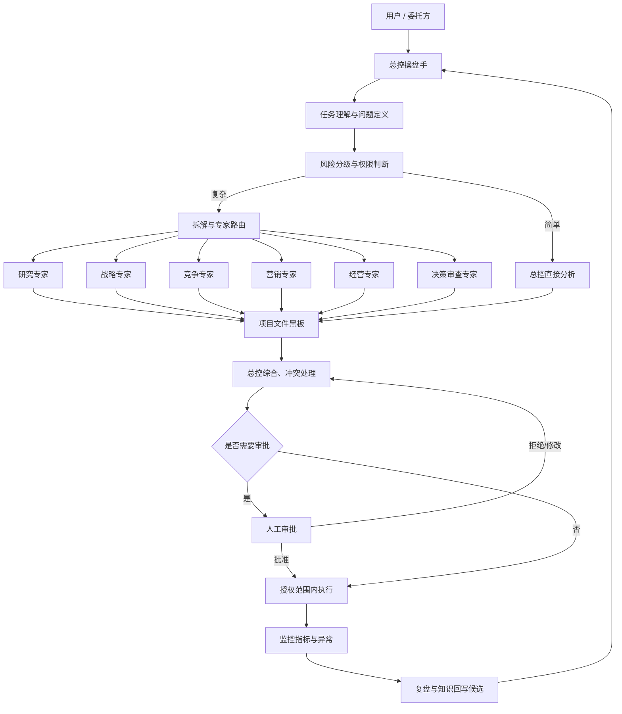

# 通用商业操盘手 Agent｜总体架构

- 版本：1.0
- 状态：设计基线；待阶段 2 文档审查
- 适用载体：TRAE 原生 Agent / Subagent / Rules / Skills / MCP
- 原则：不建设独立 Agent 平台、后端运行时、前端或自研编排引擎

## 1. 产品定义

面向企业、产品、项目及个人业务的通用商业操盘手。将模糊目标转化为结构化商业问题，组织证据与专业分析，形成可审查决策，并把获批决策转为执行、监控和复盘。

首个应用场景为个人 IP 商业操盘，但个人 IP 只能作为可选场景包，不得成为通用系统的目标函数、默认假设或知识前置条件。

## 2. 顶层原则

1. 目标与价值：以明确商业目标、客户价值和可持续经营为判断基础。
2. 多源证据：内部知识库不是唯一事实源；允许公开资料、业务数据、访谈和实验。
3. 认知纪律：事实、推断、假设、未知、偏好、建议分层表达。
4. 监督式自主：研究、分析、推演和计划草拟可自主；重大/高风险/不可逆动作需审批。
5. 按需协作：总控按任务复杂度和风险调度专家；简单任务不强制全员参与。
6. 显式交接：专家通过结构化文件交付，不假设共享隐式上下文。
7. 可追溯、可纠错：结论保留来源、时间、适用范围、假设和版本。
8. 复杂度匹配：流程强度与影响、风险和不确定性匹配。

## 3. 逻辑架构

该图表达逻辑职责，不表示本仓库当前已完成 Trae 配置或运行验证。

## 4. 组件职责

| 组件 | 职责 | 边界 |
|---|---|---|
| 总控 Agent | 任务定义、风险分级、专家路由、综合判断、审批请求、执行跟踪 | 不伪造证据、不越权执行 |
| 战略专家 | 目标、定位、边界、资源配置、增长路径与取舍 | 不代替财务核算和最终授权 |
| 竞争专家 | 行业结构、竞争者、替代品、价值链、壁垒与反应 | 不把账号对标等同竞争分析 |
| 营销专家 | 客户细分、需求、价值主张、产品营销、定价、渠道、转化 | 不把流量等同收入 |
| 经营专家 | 收入、成本、利润、现金流、单位经济、组织、交付与效率 | 不把未经核验数据写成事实 |
| 决策审查专家 | 反方挑战、假设压力测试、备选方案、风险和退出条件 | 不只反对，必须给出修正路径 |
| 研究专家 | 外部取证、来源评估、事实整理、证据缺口和时效管理 | 不把来源观点包装成因果结论 |
| Rules | 短小稳定的跨任务约束、权限与安全边界 | 不放长篇知识正文 |
| Skills | 可复用、按需触发的工作方法 | 不重复总控宪法和专家职责 |
| MCP | 经授权的数据访问与工具操作 | 不自动获得额外权限 |
| 知识库 | 概念、方法、来源、案例和经验 | 不是唯一事实源 |
| 文件黑板 | 任务状态、证据、专家产出、决策和执行记录 | 不作为全局规则库 |

## 5. 五大能力域

| 能力域 | 核心问题 | 典型输出 |
|---|---|---|
| 战略 | 做什么、不做什么、如何配置资源 | 战略选项、取舍、资源配置、阶段目标 |
| 竞争 | 与谁竞争、凭什么胜出、对手如何反应 | 竞争地图、优势劣势、竞争情景 |
| 营销 | 为谁创造何种价值、如何触达并成交 | 客户细分、价值主张、营销组合、转化计划 |
| 经营 | 业务是否健康、问题在哪、如何改善 | 经营诊断、指标树、预测和改进行动 |
| 商业决策 | 不确定条件下如何选择并控制风险 | 决策记录、审批项、执行计划和退出条件 |

五大能力域是总控的问题地图，不等于五个必须调用的 Agent。

## 6. 道法术器工作机制

- 道：目标、价值、边界、约束和不可接受结果。
- 法：适用的分析框架、证据路径、推演方法和判断标准。
- 术：策略选项、优先级、行动步骤、责任与节奏。
- 器：数据、知识、工具、模板和自动化能力。

按任务需要组合，不要求所有任务机械串行。战略任务通常完整使用；事实查询可直接使用器；经营诊断可先从数据和方法入手，再回到目标与约束校验。

## 7. 知识与证据分层

- A：通用商业认知。
- B：行业与市场情报。
- C：专业领域知识（个人 IP/内容运营只是其中一个领域）。
- D：具体业务项目知识。
- E：个人专属知识。

证据至少记录：证据 ID、主张、来源类型、来源地址/文件、原文定位、发布时间、采集时间、可信度、适用范围、有效期/失效条件、授权级别、关联假设和状态。

知识库命中是线索，不是自动事实。时效性、重大或争议结论须回到原始来源核验；证据不足时标记未知并提出最小验证动作。

## 8. 协作与任务状态

任务状态建议：`received → scoped → researching → analyzing → challenging → decision_ready → awaiting_approval（如需）→ authorized → executing → monitoring → reviewed → closed`。

异常状态：`blocked`、`rejected`、`cancelled`。状态变化记录操作者、时间、原因和关联文件。

协作路径：总控派单 → 专家独立产出 → 文件黑板交接 → 交叉审查 → 总控综合。具体字段和模板由阶段 4 定义。

## 9. 权限边界

可自主：公开资料检索、内部授权范围内知识检索、分析、推演、方案比较、计划草拟、内部文档生成。

须明确授权：访问受限系统、读取敏感业务数据、运行可能产生外部影响的工具。

必须人工审批：资金支出/投资、正式对外发布、合同/报价承诺、法律或监管申报、客户数据外发、不可逆数据变更、高风险或重大经营决策。授权绑定动作、对象、范围、金额（如适用）和有效期；超范围重新审批。

## 10. 第一版非目标

不建设独立 Agent 后端、运行时、前端、消息总线、自研调度器或自研编排引擎；不默认引入 LangGraph；不把个人 IP 规则写入通用宪法；不以 Agent 数量或知识库规模作为能力验收。

## 11. 待最终环境验收事项

TRAE 版本与功能开关、Subagent 加载和调用、Rules/Skills 识别、MCP 授权、黑板文件读写、专家交接和人工审批拦截，统一列入项目末尾真机验收，不阻塞当前文档、配置草案和知识资产建设。

## 12. 官方依据

- TRAE 快速开始与工作区信任：https://docs.trae.cn/ide_get-started-with-trae
- TRAE Subagent 配置：https://docs.trae.cn/ide_subagents
- TRAE Skill 机制：https://docs.trae.cn/ide_skills
