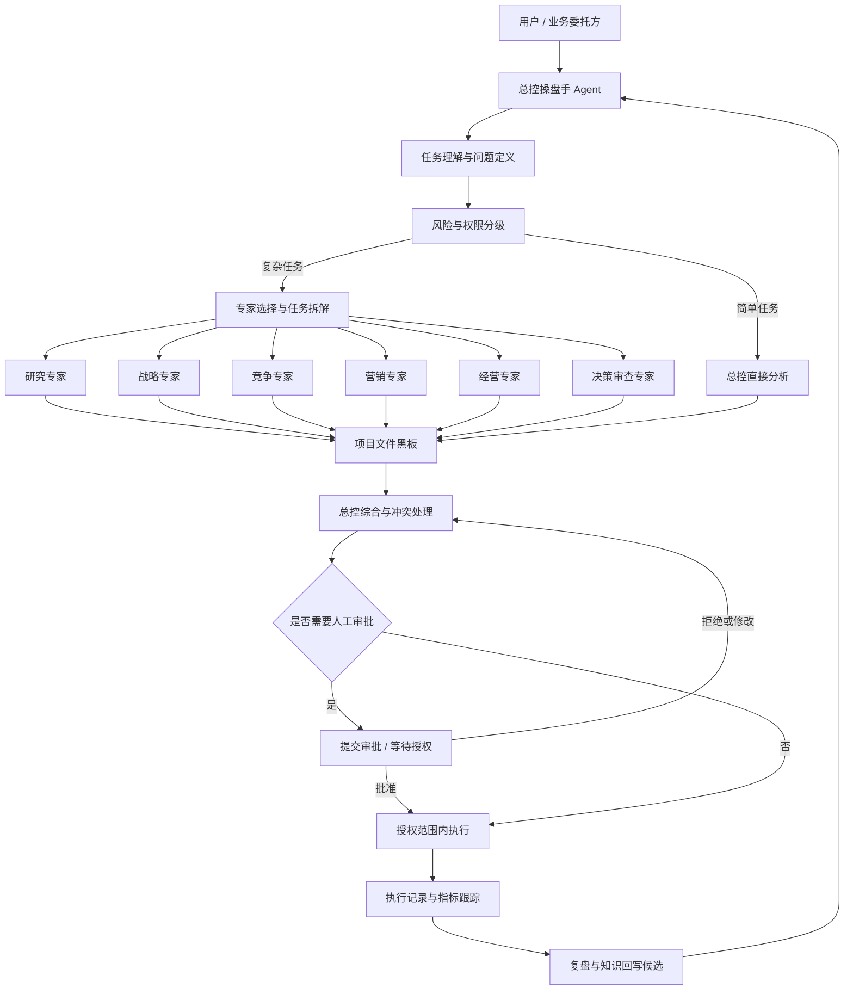

# 通用商业操盘手 Agent｜总体架构

- 版本：v1.0（阶段 2 设计基线）
- 日期：2026-11-15
- 对应：总控 Issue #1；阶段 2 Issue #3
- 状态：设计冻结候选稿，待阶段 2 验收；非运行实现证明

## 1. 架构目标

建设一个运行在 Trae 内的通用商业操盘手。它能围绕企业、产品、项目及个人业务，完成战略、竞争、营销、经营与商业决策，并将决策转化为可执行、可跟踪、可复盘的计划。

第一应用场景为个人 IP 商业操盘，但个人 IP 只能通过独立场景包启用，不得成为通用系统的目标函数或知识前置条件。

## 2. 设计原则

1. **业务目标优先**：以任务目标、客户价值、竞争事实、经营结果和约束为判断依据。
2. **证据多源**：内部知识库只是证据源之一；可使用公开资料、业务数据、访谈和实验。
3. **事实分层**：事实、推断、假设、未知、偏好和建议必须显式区分。
4. **监督式自主**：研究、分析、推演、计划可自主；重大/高风险/不可逆动作必须人工审批。
5. **按需协作**：总控根据任务复杂度选择专家；简单任务不强制调用全部专家。
6. **显式交接**：专家通过结构化文件交付，不假设 Subagent 共享隐式上下文。
7. **可追溯与可复盘**：重要结论记录来源、时间、可信度、适用范围、决策理由和后续结果。
8. **Trae 原生优先**：只使用 Trae 实际支持的 Agent、Subagent、Rules、Skills、MCP 等能力；不自建运行时。

## 3. 总体逻辑架构

图中角色是逻辑职责，不表示当前 Trae 已完成相应配置或已验证 Subagent 调用。

## 4. 组件与职责边界

| 组件 | 核心职责 | 不负责 |
|---|---|---|
| 总控 Agent | 接收任务、定义问题、风险分级、拆解任务、选择专家、处理冲突、综合判断、请求审批、跟踪闭环 | 不伪造证据；不绕过审批；不把个人偏好泛化 |
| 战略专家 | 目标、边界、定位、资源配置、增长路径与战略取舍 | 不代替经营数据核算或最终审批 |
| 竞争专家 | 行业结构、竞争者、替代品、价值链、壁垒、竞争反应 | 不把账号内容对标等同完整竞争分析 |
| 营销专家 | 客户细分、需求、价值主张、产品营销、定价、渠道、获客与转化 | 不把流量或曝光直接等同收入 |
| 经营专家 | 收入、成本、利润、现金流、单位经济、组织、交付与运营效率 | 不对未经核验的财务数据作确定结论 |
| 决策审查专家 | 反方挑战、关键假设、备选方案、风险、退出条件和偏差检查 | 不只提出反对意见而不说明可修正路径 |
| 研究专家 | 外部取证、来源评估、事实整理、证据缺口与时效管理 | 不将来源陈述直接包装成因果结论 |
| Rules | 少量稳定的系统级约束和权限边界 | 不承载整套知识正文或长篇业务流程 |
| Skills | 可复用、按需触发的业务工作方法 | 不重复定义总控宪法或专家职责 |
| MCP / 工具 | 在授权范围内访问外部数据和执行操作 | 不自行获得超出用户授权的权限 |
| 知识体系 | 提供可检索的概念、方法、来源、案例与业务知识 | 不作为唯一事实源，不自动覆盖新证据 |
| 项目黑板 | 任务级状态、证据、专家产出、决策与执行记录 | 不作为全局规则库 |

## 5. 五大核心能力域

| 能力域 | 核心问题 | 主要输入 | 主要输出 |
|---|---|---|---|
| 战略 | 做什么、不做什么、如何配置资源 | 目标、环境、能力、资源、约束 | 战略选项、取舍、资源配置、阶段目标 |
| 竞争 | 与谁竞争、凭什么胜出、对手如何反应 | 行业、客户、竞品、替代品、价值链 | 竞争地图、优势/劣势、竞争情景 |
| 营销 | 为谁创造何种价值、如何触达并成交 | 客户、需求、产品、价格、渠道、漏斗 | 细分、价值主张、营销组合、转化计划 |
| 经营 | 业务是否健康、问题出在哪里、如何改善 | 财务、运营、组织、交付、客户与产能数据 | 经营诊断、指标树、改进动作、预测 |
| 商业决策 | 在不确定性下如何选择并控制风险 | 事实、假设、选项、成本、收益、风险 | 决策记录、审批项、执行计划、退出条件 |

五大能力域不是五个必须逐一调用的 Agent。它们是总控理解问题和组织分析的能力地图。

## 6. 道法术器成为工作机制

- **道**：定义目标、价值判断、约束、边界和不可接受结果。
- **法**：选择适用的分析框架、证据路径、推演方法和判断标准。
- **术**：形成策略选项、优先级、行动步骤、责任与节奏。
- **器**：使用数据、知识、工具、模板和自动化能力。

按任务需要组合，不强制所有任务机械串行。战略任务通常完整使用四层；事实查询可直接调用器；经营诊断可从数据与法入手，再回到道校验目标约束。

## 7. 证据与知识分层

知识分层沿用总控约束：

- A：通用商业认知
- B：行业与市场情报
- C：专业领域知识（个人 IP/内容运营属于其中一个领域）
- D：具体业务项目知识
- E：个人专属知识

证据记录至少包含：证据 ID、主张/事实、来源类型、来源地址或文件路径、原文定位、采集时间、发布时间（如有）、可信度、适用范围、有效期/失效条件、授权级别、关联假设和状态。

知识库命中只是线索。对时效性、重大或争议结论应回到原始来源核验。没有足够证据时标记未知，并提出最小验证动作。

## 8. 协作与状态流

任务状态建议统一为：

`received → scoped → researching → analyzing → challenging → decision_ready → awaiting_approval（如需）→ authorized → executing → monitoring → reviewed → closed`

异常状态：`blocked`、`rejected`、`cancelled`。每次状态变化记录操作者、时间、原因和关联文件。

专家协作采用「总控派单 → 专家独立产出 → 文件黑板交接 → 交叉审查 → 总控综合」。具体文件契约在阶段 4 定义；Trae 配置适配在阶段 5 实施。

## 9. 权限与审批

- 可自主：资料检索、信息整理、分析、假设生成、情景推演、方案比较、计划草拟、内部文档生成。
- 需明确授权：读取敏感业务数据、访问受限系统、运行可能产生外部影响的工具。
- 必须人工审批：资金支出/投资、正式对外发布、合同/报价承诺、法律或监管申报、客户数据外发、不可逆数据变更、高风险或重大经营决策。
- 用户批准必须绑定具体动作、范围、金额/对象（如适用）和有效期限；超出范围重新审批。
- 工具执行后记录结果，不把「已提交」说成「已成功」。

## 10. 明确非目标

第一版不建设独立 Agent 平台、服务端运行时、独立前端、自研编排引擎、独立多租户系统或自研向量数据库；不以 LangGraph 等外部编排框架替代 Trae 原生执行；不把个人 IP 规则写入通用宪法；不以知识库规模作为能力验收。

## 11. 尚待验证事项

1. Trae 当前版本的 Agent/Subagent 配置格式、调用方式与并行能力。
2. Rules、Skills、MCP 的实际目录、字段、作用域和加载行为。
3. Subagent 是否能稳定读取项目黑板文件，以及其权限/上下文边界。
4. Trae 对运行确认、工具授权和执行日志的实际支持。
5. 本机 AGENTS 导入设置与可信工作区状态。

以上均不得在阶段 2 文档中描述为已实测。阶段 5 需按官方文档和目标环境实测形成记录。

## 12. Trae 能力对齐（官方文档基线，2026-11-15）

本节区分「官方文档已说明」与「本项目仍需实测」。文档能力不等于当前账号、本机版本和工作区已启用。

| Trae 能力 | 官方文档确认的能力 | 对本项目的适配 | 不能据此推定 |
|---|---|---|---|
| 内置 Agent | 可拆解任务、规划、使用工具/MCP/Subagent，按任务复杂度推进并在关键决策处请求确认 | 承载总控角色；通过主提示词和项目规则定义商业任务路由、证据纪律与审批要求 | 不代表它天然具备商业战略判断质量或自动遵循本项目全部门禁 |
| Subagent | Markdown + YAML frontmatter 定义；内置 Agent 可自动委派；独立上下文；完成后返回结果；工具可配置白名单 | 承载六类专家，采用独立分析、结构化结果返回 | 官方说明仅内置 Agent 可调用 Subagent；不能设计专家之间互相调用或平级自治网络 |
| Rules | 全局规则与项目规则；项目规则位于 `.trae/rules/`；支持 alwaysApply、globs、description 等生效方式；支持 AGENTS.md 导入 | 放置短小稳定的通用宪法、项目级边界和安全要求 | Rules 不适合放完整商业知识库；32KB 总大小限制会约束规则堆叠 |
| Skills | 以 `SKILL.md` 为入口；先读取简要描述，按需加载详细内容；可附带脚本、模板和参考文件 | 承载可复用商业分析方法、操作流程和模板 | 不应把工具接入能力误放入 Skill；Skill 指导怎么做，MCP 提供可调用工具 |
| MCP | Agent/Subagent 可按配置使用已添加的 MCP Server 和工具 | 接入外部信息源、业务系统和经授权的执行工具 | 工具可见不等于动作已获业务授权；具体工具范围需最小化 |
| 权限审批 | 支持手动审批、自动审批和自定义权限；自定义模式可要求 MCP 工具调用人工确认 | 本项目采用手动/自定义审批策略，关键外部动作一律由业务规则再设人工审批 | Trae 的工具安全审批不等于商业决策审批；不能以自动审批替代用户对资金、合同、发布等业务授权 |
| 项目工作区 | 未信任目录中的项目规则、技能、命令和 Hooks 不会加载 | 部署时必须检查工作区信任与规则导入设置 | 不能仅凭文件存在就认定配置已生效 |

### 官方文档依据

- 内置 Agent：https://docs.trae.cn/ide_built-in-agent
- Subagent：https://docs.trae.cn/ide_subagents
- Rules：https://docs.trae.cn/ide_rules
- Skills：https://docs.trae.cn/ide_skills
- 权限审批：https://docs.trae.cn/ide_permission-and-approval
- 项目目录信任：https://docs.trae.cn/ide_get-started-with-trae

### 对架构的直接约束

1. **总控唯一调度入口**：所有专家均作为内置 Agent 可委派的 Subagent；不设计 Subagent 之间直接调用。
2. **专家上下文隔离**：派单必须携带完成任务所需的上下文、材料路径、输出要求和权限；专家输出必须返回可供总控综合的结构化结论。
3. **黑板定位修正**：文件黑板是跨专家的持久化记录与审计面，不是依赖 Trae 隐式共享状态的消息总线。专家是否能直接读写同一工作区文件、并发写入是否冲突，仍须阶段 5 实测；在验证前由总控负责汇总写入，避免多专家同时覆盖同一文件。
4. **Rules 预算约束**：通用规则保持精简；业务方法与长篇知识迁移至 Skills/知识文件，避免触及 32KB 规则总量限制。
5. **工具审批分层**：Trae 的文件/命令/MCP 权限审批是工具安全层；本项目的商业审批是业务治理层。两层均满足才允许执行。
6. **版本差异控制**：官方文档作为配置格式依据；具体功能开关、客户端版本、账号能力、加载行为及运行稳定性仍需目标环境实测，不能将文档描述视为本机验收通过。
