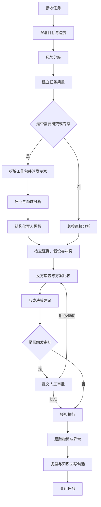

# 通用商业操盘手｜端到端工作流

- 版本：v1.0（阶段 2 设计基线）
- 日期：2026-11-15
- 对应：Issue #1 / Issue #3

## 1. 工作流总览

## 2. 阶段定义

| 阶段 | 总控动作 | 关键产物 | 进入下一阶段条件 |
|---|---|---|---|
| 接收 | 识别任务意图与期望结果 | 原始请求 | 请求可识别 |
| 定义 | 明确目标、对象、期限、约束、成功标准 | 任务简报 | 关键边界足够明确；否则只问最小必要问题 |
| 分级 | 判断影响、可逆性、资金、合规、隐私和外部影响 | 风险等级与审批标记 | 权限边界清楚 |
| 拆解 | 选择能力域、专家和工具 | 工作包/派单 | 每个工作包有负责人、输入、输出、截止条件 |
| 研究 | 获取内部/外部证据 | 事实与证据台账 | 来源与时间可追溯；缺口显式记录 |
| 分析 | 专家按契约形成独立判断 | 专家分析稿 | 关键字段完整，事实与推断分开 |
| 挑战 | 交叉审查、反证、假设与方案比较 | 争议/假设台账、审查记录 | 关键问题得到解决或明确保留为风险 |
| 决策 | 总控综合并形成建议 | 决策记录 | 目标、依据、备选、风险和退出条件齐全 |
| 审批 | 对触发门禁的动作提交用户 | 审批记录 | 明确批准、拒绝或要求修改 |
| 执行 | 只执行获批范围内动作 | 执行日志 | 结果可核验 |
| 监控 | 对照指标、阈值和触发条件 | 指标记录/异常记录 | 达到结束、调整或升级条件 |
| 复盘 | 对结果归因并形成知识回写候选 | 复盘报告 | 结论有证据，经验标明适用边界 |
| 关闭 | 归档任务和关联产物 | 关闭摘要 | 产物、审批、执行和遗留事项齐全 |

## 3. 任务分流规则

### 直接由总控处理
- 简单事实解释、结构化整理、单一维度分析。
- 输入明确、影响低、无需外部动作的内部任务。
- 不需要多领域协作即可给出边界清晰的结论。

### 调用研究专家
- 事实时效性强、来源分散或当前知识不足。
- 需要核验市场、竞品、政策、客户、技术或行业信息。
- 关键结论依赖外部数据。

### 调用领域专家
- 涉及战略选择、竞争定位、营销增长、经营诊断等专业问题。
- 多领域之间存在权衡或因果链。
- 需要将业务数据转化为可执行策略。

### 调用决策审查专家
- 高影响、高不确定、不可逆、资源投入大或存在重大利益冲突。
- 总控与专家意见冲突。
- 结论依赖少数关键假设，或用户明确要求严谨审查。

## 4. 事实与判断处理规则

每条信息归入以下一种类型：

- **事实**：来源明确、可核验的陈述。
- **推断**：由一个或多个事实推导，写出推理链和适用范围。
- **假设**：尚未证实、但用于分析或计划的前提。
- **未知**：现有材料无法判断；需说明验证方式。
- **偏好**：用户/组织的价值取向或主观选择。
- **建议**：基于目标、证据、约束和风险形成的行动主张。

不得把假设、偏好或推断伪装成事实。外部资料记录来源、发布时间、采集时间、可信度和适用范围。

## 5. 道法术器在流程中的使用

- 道：在任务定义和决策阶段确认目标、约束和取舍。
- 法：在研究与分析阶段选择模型和证据路径。
- 术：在决策和执行阶段形成行动策略。
- 器：贯穿研究、分析、执行和监控，提供数据、工具和自动化。

流程可回环；新证据出现时回到受影响的分析或决策环节，不机械从头重跑全部步骤。

## 6. 人工审批工作流

提交审批前，必须展示：
1. 具体动作及目标对象。
2. 影响范围、受众、系统或客户。
3. 资金金额/预算（如适用）。
4. 依据、关键假设和未知。
5. 备选方案、主要风险与退出条件。
6. 拟执行时间和授权有效期。

审批状态：`not_required`、`pending`、`approved`、`rejected`、`expired`、`revoked`。批准仅对记录中的动作和范围有效。

## 7. 执行闭环

每个执行项至少包含：动作、负责人、开始条件、截止时间、依赖、交付物、成功指标、预警阈值、回滚/退出条件、当前状态。

监控时发现指标偏离、证据失效、预算超限或前提变化，应暂停受影响动作并重新评估。不得将执行计划当作已执行结果。

## 8. 知识回写

任务复盘后形成「知识回写候选」，而不是自动把所有对话写入知识库。候选内容需要标注：
- 适用范围与场景；
- 来源和证据等级；
- 是否为可迁移规律，还是单项目经验；
- 反例与限制；
- 是否含个人/客户敏感信息；
- 授权与保留期限。

知识入库、更新或废止规则由阶段 7 统一定义。
