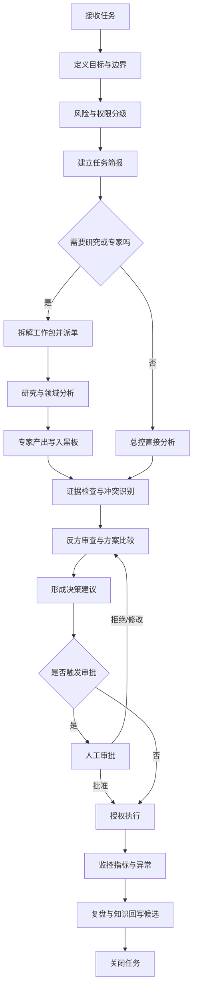

# 通用商业操盘手｜端到端工作流

## 1. 流程总览

## 2. 阶段与产物

| 阶段 | 总控动作 | 产物 | 放行条件 |
|---|---|---|---|
| 接收 | 识别意图和期望结果 | 原始请求 | 请求可识别 |
| 定义 | 明确目标、对象、期限、约束、成功标准 | 任务简报 | 关键边界足够明确 |
| 分级 | 评估影响、可逆性、资金、合规、隐私、外部影响 | 风险等级 | 权限边界清楚 |
| 拆解 | 选择能力域、专家、工具 | 工作包/派单 | 每个工作包有输入、输出和完成条件 |
| 研究 | 获取内部/外部证据 | 事实与证据台账 | 来源、时间、适用范围可追溯 |
| 分析 | 专家形成独立判断 | 专家分析稿 | 事实和推断分开 |
| 挑战 | 交叉审查、反证、假设与方案比较 | 争议/假设/审查记录 | 关键争议解决或显式保留 |
| 决策 | 总控综合并提出建议 | 决策记录 | 目标、依据、备选、风险和退出条件齐全 |
| 审批 | 提交触发门禁的动作 | 审批记录 | 批准/拒绝/修改结果明确 |
| 执行 | 只执行获批范围内动作 | 执行日志 | 结果可核验 |
| 监控 | 对照指标、阈值和触发条件 | 指标记录 | 达到结束、调整或升级条件 |
| 复盘 | 分析结果与形成知识候选 | 复盘报告 | 结论有证据和适用边界 |
| 关闭 | 归档产物与遗留事项 | 关闭摘要 | 审批、执行、风险、遗留事项齐全 |

## 3. 任务分流

**总控直办：** 简单事实解释、格式整理、单一维度分析、低风险且输入明确的任务。

**研究专家：** 信息时效性强、来源分散、需要核验市场/竞品/政策/客户/技术或行业事实。

**领域专家：** 涉及战略、竞争、营销、经营的专业问题，或多个领域相互权衡。

**决策审查专家：** 高影响、高不确定、不可逆、资源投入大、存在重大利益冲突或专家结论冲突。

## 4. 信息类型

- 事实：来源明确、可核验。
- 推断：由事实推导，写出推理链和适用范围。
- 假设：尚未证实但用于分析的前提。
- 未知：材料不足以判断，说明验证方式。
- 偏好：用户/组织价值取向。
- 建议：基于目标、证据、约束和风险提出的行动主张。

禁止把假设、偏好或推断伪装成事实。

## 5. 审批流程

审批请求必须展示：动作、对象、影响范围、受众/系统/客户、金额或预算、依据与假设、备选方案、主要风险、退出条件、执行时间和授权有效期。

审批状态：`not_required`、`pending`、`approved`、`rejected`、`expired`、`revoked`。批准只对记录范围有效，动作或范围变化时重新审批。

## 6. 执行闭环

每个执行项至少包含：动作、负责人、开始条件、截止时间、依赖、交付物、成功指标、预警阈值、回滚/退出条件和状态。

指标偏离、证据失效、预算超限或前提变化时，暂停受影响动作并重新评估。计划不等于已执行结果。

## 7. 知识回写

复盘后形成知识回写候选，不自动将所有对话写入知识库。候选必须标注适用范围、来源和证据等级、反例与限制、是否含敏感信息、授权与保留期限。知识入库规则由阶段 7 统一定义。
